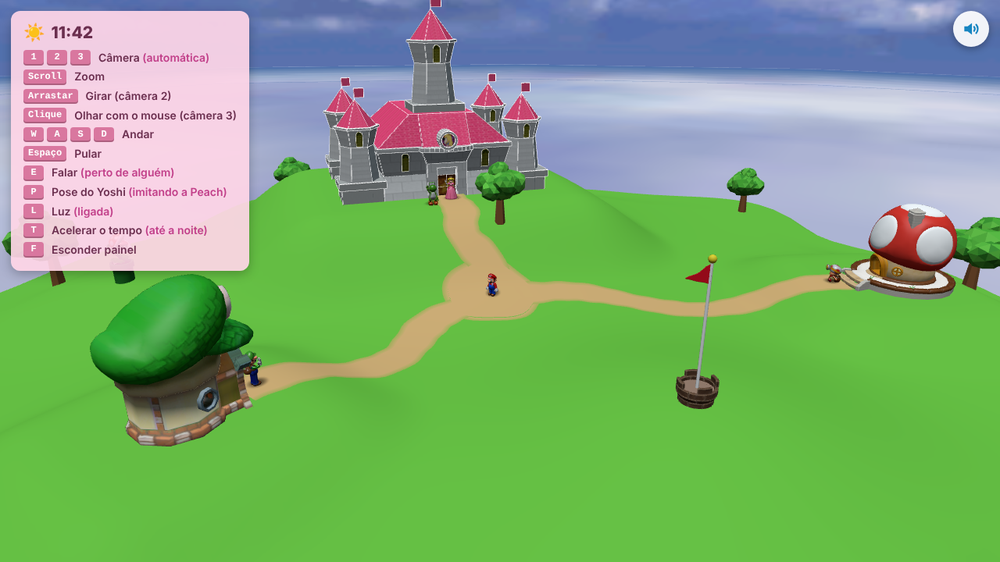
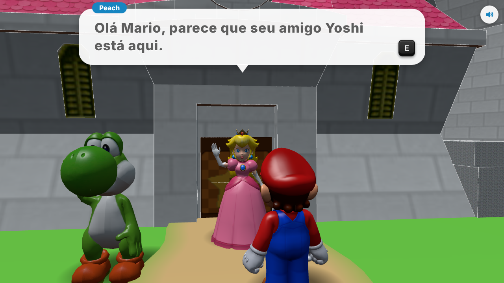
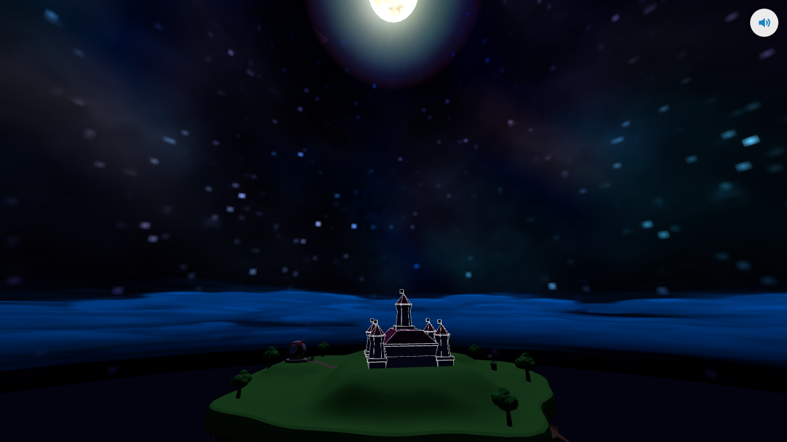

# Ilha Voadora do Reino dos Cogumelos 🍄

- **Cena:** https://kamillasilveira16.github.io/utf-cg-tp2
- **Repositório:** https://github.com/kamillasilveira16/utf-cg-tp2

## A Cena

Uma ilha flutuando no céu, inspirada no Reino dos Cogumelos dos jogos do Mario. Nela ficam o castelo da Peach, a casa do Toad e a casa do Luigi, ligados por estradinhas de terra, além de árvores e de um poste com bandeira que balançam com o vento e de uma planta piranha mordendo sem parar. O jogador controla o Mario e pode conversar com a Peach, o Capitão Toad, o Luigi e o Yoshi, que troca de pose correndo até cada um deles para imitá-los. O tempo passa: o dia vira noite, com céu estrelado e lua.

### Controles

| Tecla | Ação |
| --- | --- |
| `1` `2` `3` | Câmera: automática (padrão), orbital com o mouse, terceira pessoa |
| `Scroll` | Zoom |
| `W` `A` `S` `D` / `Espaço` | Andar / pular com o Mario |
| `E` | Conversar (perto de um personagem) |
| `P` | Trocar a pose do Yoshi |
| `L` | Ligar/desligar a iluminação |
| `T` | Acelerar o tempo até a noite (ou até o dia) |
| `F` | Mostrar/esconder o painel de teclas |

## Criador(es)

- **João Pedro Oliveira Guimarães**: joaopedrooliveiraguimaraes04@gmail.com
- **Kamilla Silveira da Silva**: kamilasilveiradasilva@gmail.com

## Media kit

## Opcionais

1. ⭐ **Modelos tridimensionais:** em vez de usar os sólidos próprios ou da TWGL.js, crie ou use modelos tridimensionais de terceiros e carregue-os no seu programa. Um formato simples é o .obj (mas ele não suporta animação). Tem também o formato glTF (mais complexo mas suporta animação)
   > Na cena: Mario (.fbx), Peach, Capitão Toad, Luigi, Yoshi, castelo e casa do Toad (.dae), casa do Luigi e planta piranha (.obj), poste com bandeira (.gltf) e os dois céus.

2. ⭐ **Skybox, skyphere ou skydome:** se considerarmos que nosso mundo está definido dentro de um cubo (skybox), podemos colocar uma imagem de textura em cada face interna (são 6) que represente o horizonte naquela direção. Veja exemplos de texturas de skyboxes e nossa aula sobre efeitos visuais. Repare que o cubo do skybox acompanha a posição, ou seja, não é possível se aproximar de uma parede, muito menos sair do cubo
   > Na cena: skydome que acompanha a posição da câmera (`src/sky.js`), um para o dia e outro para a noite.

3. **Chão com relevo:** em vez de plano, faça com que o chão tenha relevo. Uma ideia é usar um height-map: uma textura em escala de cinza em que cada texel representa a altura do chão naquele pixel. Veja um exemplo de height map na aula sobre texturas
   > Na cena: a ilha tem morros (onde ficam o castelo, as casas, a bandeira e a planta piranha), e os personagens acompanham o relevo ao andar (`src/island.js`).

4. **Vários tipos de objetos:** em vez de compor o cenário com apenas 03 tipos de objetos, tenha uns 07 tipos diferentes para dar variedade
   > Na cena: castelo, casa do Toad, casa do Luigi, árvores, poste com bandeira, planta piranha, estradas de terra e pedras flutuando embaixo da ilha.

5. ⭐ **Vento:** simule que existe vento e faça as coisas mexerem com ele. Por exemplo, aplique um shear com uma intensidade dada, em um certo momento, por uma textura que contém ruído branco (eg, perlin noise). Moitas de grama e a copa das árvores podem sofrer essa transformação
   > Na cena: shear no vertex shader com intensidade lida de uma textura de Perlin noise que "sopra" pela ilha; afeta a copa das árvores e a bandeira (`src/wind.js`).

6. 💣 **Animação de personagem:** faça o personagem executar um clipe de animação que altera as coordenadas de seus vértices ao longo do tempo (técnicas de skinning ou de blend shapes)
   > Na cena: a corrida do Mario e a do Yoshi deformam a malha pelos ossos do esqueleto (skinning), com o movimento gerado por código (`src/marioAnimations.js`, `src/yoshi.js`).

7. **Poses alternativas:** ao alternar as poses do personagem com P, além de mudar a posição e orientação, coloque-o de fato em outra pose (eg, sentado, deitado, dormindo)
   > Na cena: o Yoshi tem 3 poses de corpo diferentes, imitando quem está do lado: acenando (Peach), dando um passo animado (Capitão Toad) e assustado (Luigi).

8. 🍔 **Ciclo dia/noite:** faça o tempo passar e que isso defina na forma como o cenário é renderizado. Isso pode ser feito configurando-se a fonte de luz direcional com cores diferentes, dependendo da hora do dia
   - Se tiver um skybox, você deve alterá-lo para refletir os horários diferentes
   > Na cena: a luz direcional é o sol de dia (muda de cor e de posição) e a lua à noite; o céu do dia some aos poucos e dá lugar ao céu noturno (`src/daynight.js`).

9. 💣 **Sombras:** faça objetos projetarem sombras de acordo com a(s) fonte(s) de luz da cena
   > Na cena: sombras do tipo "blob" embaixo dos personagens, que se deslocam, esticam e mudam de força conforme a posição e a intensidade da luz (`src/shadows.js`).

10. 💣 **Normal mapping:** use a técnica de normal mapping para fazer com algum objeto tenha suas normais dadas por uma textura e, assim, ganhe um efeito de profundidade quando iluminado
    > Na cena: a pele do Yoshi e o bloco de tijolos da base da bandeira usam normal maps.

11. 🌟 **Música, efeitos sonoros e/ou som ambiente:** inclua música de fundo, sons ambiente e efeitos sonoros (este último, caso haja algum tipo de interação)
    > Na cena: música de fundo, som de pulo do Mario e a voz de cada personagem ao começar uma conversa, com botão de volume no canto superior direito (`src/music.js`).

### Parcialmente implementados

12. ⭐ **Interação (carinho):** torne possível fazer um carinho no bichinho usando o mouse. Deve ter algum feedback: emitir um som, animação de alegria, surgir um balãozinho com rosto feliz etc.
    > Na cena (parcial): chegando perto de um personagem (Peach, Capitão Toad, Luigi ou Yoshi) e apertando `E`, o Mario conversa com ele. O personagem dá um som de voz e aparecem balões de fala. A interação é pelo teclado, não pelo mouse (`src/dialogue.js`).

13. 💣 **Movimentação autônoma:** dê vida ao personagem fazendo-o andar pelo cenário. Deve haver uma máquina de estados com pelo menos as situações: (a) idle e (b) wandering. O personagem deve andar apenas por locais válidos
    - Pode ser necessário ter um grafo não direcionado em que cada nó representa um possível local de destino e as arestas existem entre nós que podem ser alcançados andando em linha reta
    - Ao entrar em wandering, o grafo pode ser consultado para escolher um nó alvo que seja alcançável a partir da navegação de algumas arestas escolhidas de forma aleatória
    > Na cena (parcial): o Mario anda pelo cenário (parado ou correndo, com animação para cada estado), só por locais válidos: ele colide com as construções, os personagens, as árvores e a borda da ilha. Quem o move é o jogador (`src/mario.js`).

14. 💣 **Clique em objetos:** para torná-los o alvo da câmera
    - Isto envolve object picking e há diferentes abordagens
    > Na cena (parcial): ao conversar com um personagem, ele se torna o alvo da câmera, que vai suavemente até ele e volta para o Mario quando a conversa acaba. O personagem é escolhido por proximidade com o Mario, não por clique (`src/dialogue.js`).

15. ⭐ **Câmera de navegação livre com WASD para voar e mouse para mudar direção**
    > Na cena (parcial): a câmera 3 segue o Mario, que é controlado com `W` `A` `S` `D` na direção para onde a câmera olha. Clicando na tela, o mouse gira a câmera em volta dele e o scroll aproxima ou afasta (`src/cameras.js`).

## Créditos

### Modelos 3D

- [The Models Resource](https://models.spriters-resource.com/):
  - Mario.
  - Castelo da Peach (*Super Mario 64*).
  - Casa do Toad (*Super Mario 3D Land*).
  - Casa do Luigi (*Dance Dance Revolution: Mario Mix*).
  - Peach, Capitão Toad e Luigi.
  - Planta piranha (troféu de *Super Smash Bros. Brawl*).
  - Yoshi: "Ripped by Mystie from The VG Resource, thanks to Random Talking Bush's model importing script".
  - Céu do dia (*Sonic Adventure DX: Director's Cut*, fase Sky Chase).
  - Céu da noite (*Super Mario Sunshine*).
- [Sketchfab](https://sketchfab.com/feed):
  - Poste com bandeira: "[Mario Goal Flag](https://sketchfab.com/3d-models/mario-goal-flag-23a80bac8ea8444d9a58f44a063692bf)" by [matthewlok](https://sketchfab.com/matthewlok), licensed under [CC-BY-4.0](http://creativecommons.org/licenses/by/4.0/).

### Música e efeitos sonoros

- Música de fundo: "[Prologue](https://www.youtube.com/watch?v=TfDckB73Izw)", da trilha de *Super Mario Galaxy 2*.
- Som de pulo do Mario e vozes da Peach, do Toad, do Luigi e do Yoshi: [101 Soundboards](https://www.101soundboards.com/).

### Bibliotecas

- [THREE.js](https://threejs.org/)

*Mario, Peach, Luigi, Toad, Yoshi e demais personagens são marcas da Nintendo; Sonic Adventure DX é da SEGA. Este é um trabalho acadêmico, sem fins comerciais.*
